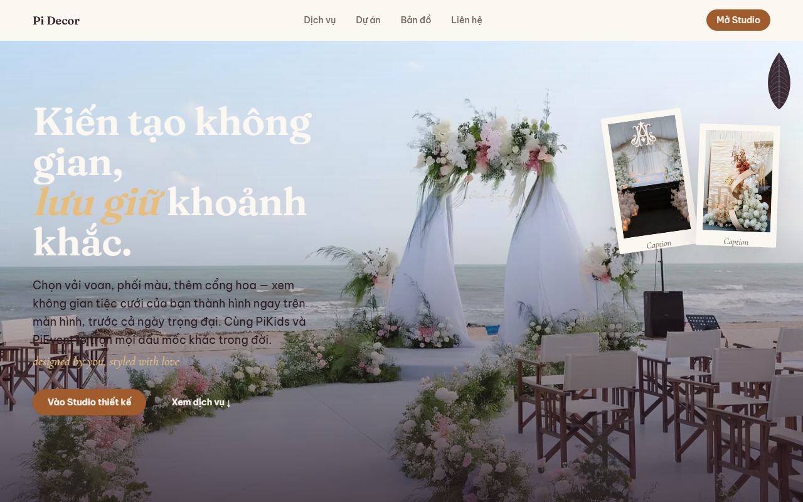
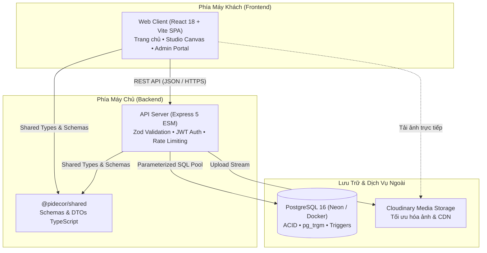

# Pi Decor — Nền Tảng Thiết Kế & Trang Trí Tiệc Cưới

[](https://github.com/QuocAnh19/Pi_Decor/actions/workflows/ci.yml)
[](LICENSE)
[](.nvmrc)
[](packages/shared)

> **Bản quyền**: Mã nguồn độc quyền, xem [LICENSE](LICENSE).

Pi Decor là nền tảng số hóa dịch vụ trang trí tiệc cưới và sự kiện cao cấp, kết hợp xưởng Studio phối cảnh 2D trực quan cho khách hàng và hệ thống CRM quản trị toàn diện. Hệ thống cho phép cô dâu chú rể tự tay tùy biến phông cưới, xem bộ sưu tập Lookbook thực tế và nhận dự toán chi phí minh bạch trong vòng 60 giây. Toàn bộ giải pháp được xây dựng theo kiến trúc monorepo hiện đại, bảo mật đa tầng và tuân thủ nghiêm ngặt quy định bảo vệ dữ liệu cá nhân theo Nghị định 13/2023/NĐ-CP.



---

## 1. Sơ Đồ Kiến Trúc Rút Gọn



---

## 2. Bảng Công Nghệ Cốt Lõi

| Tầng Hệ thống     | Công nghệ / Thư viện            | Vai trò & Mục đích sử dụng                                                                       |
| :---------------- | :------------------------------ | :----------------------------------------------------------------------------------------------- |
| **Monorepo**      | npm workspaces                  | Quản lý đa dự án trong một kho lưu trữ duy nhất (`apps/web`, `apps/api`, `packages/shared`)      |
| **Frontend**      | React 18, Vite, TypeScript      | SPA hiệu năng cao, SCSS Modules theo Design Tokens, TanStack Query đồng bộ dữ liệu               |
| **Backend**       | Node.js v20, Express 5 ESM      | Kiến trúc Module hóa (`routes` → `controller` → `service` → `repository`), bảo mật Helmet & CORS |
| **Cơ sở Dữ liệu** | PostgreSQL 16 (Neon Serverless) | Lưu trữ quan hệ, khóa ngoại toàn vẹn, tìm kiếm Trigram tiếng Việt, đánh số báo giá nguyên tử     |
| **Media CDN**     | Cloudinary                      | Lưu trữ hình ảnh sản phẩm, kiểm duyệt MIME allowlist và tự động tạo biến thể ảnh tối ưu          |
| **Bảo mật**       | JWT, bcryptjs, DOMPurify        | Refresh token xoay vòng, băm mật khẩu 10 rounds, lọc mã độc XSS trong tệp vector SVG             |
| **Kiểm thử**      | Vitest v8, Playwright           | Kiểm thử đa tầng: Unit test, Integration test cơ sở dữ liệu thật, E2E test và Visual regression  |

---

## 3. Hướng Dẫn Chạy Cục Bộ (Local Quickstart)

### Bước 1: Khởi động Cơ sở dữ liệu PostgreSQL

```bash
docker compose up -d
```

_(Cơ sở dữ liệu sẽ sẵn sàng tại `localhost:5432` với user `pidecor`)_

### Bước 2: Thiết lập Biến Môi trường

```bash
cp apps/api/.env.example apps/api/.env
cp apps/web/.env.example apps/web/.env
```

_(Điền `JWT_SECRET` ngẫu nhiên tối thiểu 32 ký tự và `ADMIN_PASSWORD` tối thiểu 12 ký tự vào `apps/api/.env`)_

### Bước 3: Cài đặt Dependencies & Khởi tạo Dữ liệu

```bash
# Bắt buộc chạy tại thư mục gốc repository
npm install

# Áp dụng migration schema và nạp dữ liệu mẫu ban đầu
cd apps/api && npm run migrate && npm run seed && cd ../..
```

### Bước 4: Khởi chạy Ứng dụng Phát triển

```bash
# Chạy đồng thời cả Frontend và Backend từ thư mục gốc
npm run dev:api    # Backend API lắng nghe tại http://localhost:4000
npm run dev:web    # Frontend Web giao diện tại http://localhost:5173
```

- **Tài khoản quản trị viên mặc định**: `admin@pidecor.vn` / mật khẩu đã đặt trong `apps/api/.env`.
- **Kiểm tra trạng thái sẵn sàng**: `curl http://localhost:4000/api/health`

---

## 4. Kiểm Tra Chất Lượng & Đo Lường

```bash
# 1. Kiểm tra toàn diện mọi quy chuẩn (Typecheck, Lints, Knip, Tests, Build)
npm run verify

# 2. Đo lường chỉ số kỹ thuật thực tế (Gzip bundle, LOC, coverage, trùng lặp mã)
npm run metrics

# 3. Tự động chụp bộ ảnh màn hình hướng dẫn sử dụng
npm run docs:screenshots

# 4. Chạy bộ kiểm thử tự động End-to-End với Playwright
npm run e2e
```

---

## 5. Danh Mục Tài Liệu Chi Tiết

Toàn bộ tài liệu nghiệp vụ, kiến trúc và vận hành được tập trung tại thư mục [`docs/`](docs/README.md):

- 📖 **[Mục lục Toàn bộ Tài liệu (docs/README.md)](docs/README.md)**: Chỉ mục điều hướng toàn bộ 78+ tệp tài liệu dự án.
- 👨‍💼 **[Cẩm Nang Quản Trị Hệ Thống (ADMIN_GUIDE.md)](docs/user-guide/ADMIN_GUIDE.md)**: Hướng dẫn chi tiết từng bước cho chủ doanh nghiệp kèm ảnh chụp màn hình trực quan.
- ❓ **[Câu Hỏi Thường Gặp (FAQ.md)](docs/user-guide/FAQ.md)**: Giải đáp các thắc mắc và tình huống thường gặp của quản trị viên.
- 📊 **[Nghiên Cứu Điển Hình (CASE_STUDY.md)](docs/CASE_STUDY.md)**: Bài viết chuyên sâu cho portfolio kèm các chỉ số kỹ thuật đo lường thực tế.
- 🏗️ **[Sơ Đồ Kiến Trúc C4 (C4.md)](docs/architecture/C4.md)** & **[Quyết Định Kiến Trúc (ADRs)](docs/adr/0000-template.md)**: Mô hình kiến trúc đa tầng và danh mục 13 bản ghi ADR.
- 🛠️ **[Sổ Tay Vận Hành & Khắc Phục Sự Cố (RUNBOOK.md)](docs/RUNBOOK.md)**: Quy trình triển khai, backup, phục hồi thảm họa và xử lý sự cố.
