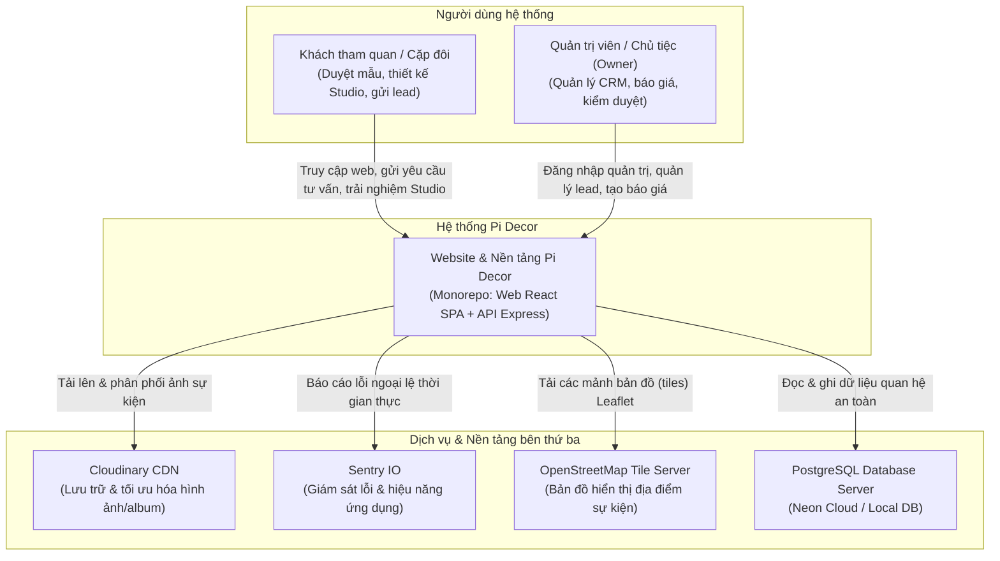
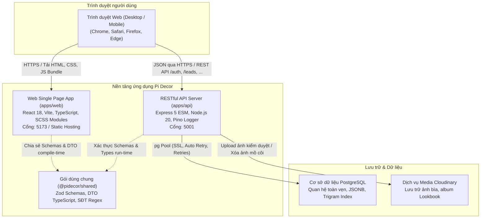
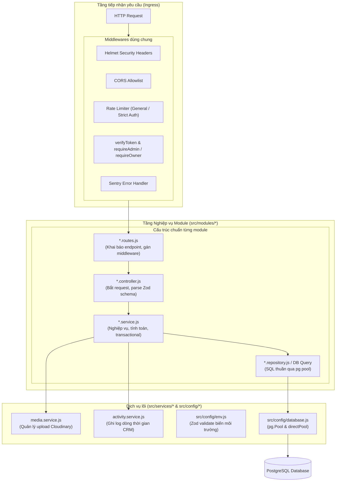
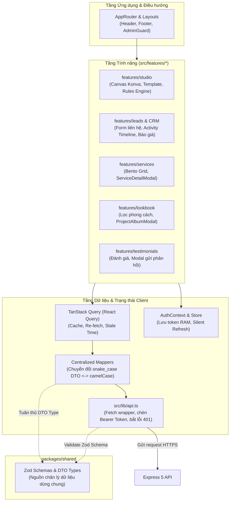

# Mô Hình Kiến Trúc C4 Hệ Thống Pi Decor (C4.md)

Tài liệu mô tả kiến trúc phần mềm Pi Decor theo mô hình C4 (Context, Containers, Components) trực quan hóa bằng Mermaid.

---

## 1. C4 Level 1: Ngữ Cảnh Hệ Thống (System Context)

Mô tả sự tương tác giữa người dùng, hệ thống Pi Decor và các dịch vụ bên thứ ba.

---

## 2. C4 Level 2: Sơ Đồ Container (Containers Diagram)

Mô tả các container độc lập cấu thành giải pháp phần mềm Pi Decor và giao thức truyền thông giữa chúng.

---

## 3. C4 Level 3: Thành Phần API Backend (apps/api Components)

Mô tả cấu trúc module hóa phân tầng (Layered Modular Architecture) của dịch vụ `apps/api`.

---

## 4. C4 Level 3: Thành Phần Web Frontend (apps/web Components)

Mô tả luồng dữ liệu, quản lý trạng thái và kiến trúc module của ứng dụng `apps/web`.

