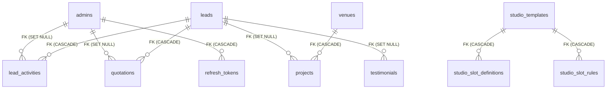
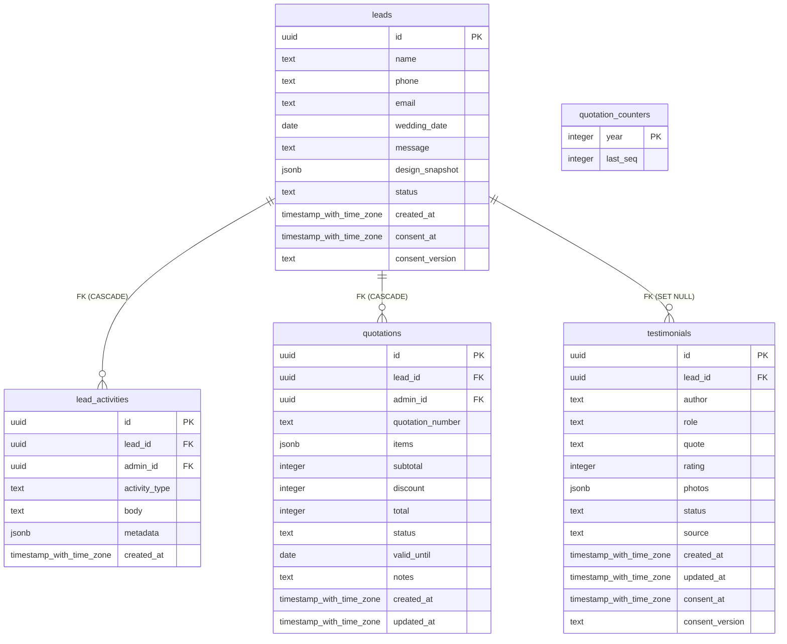
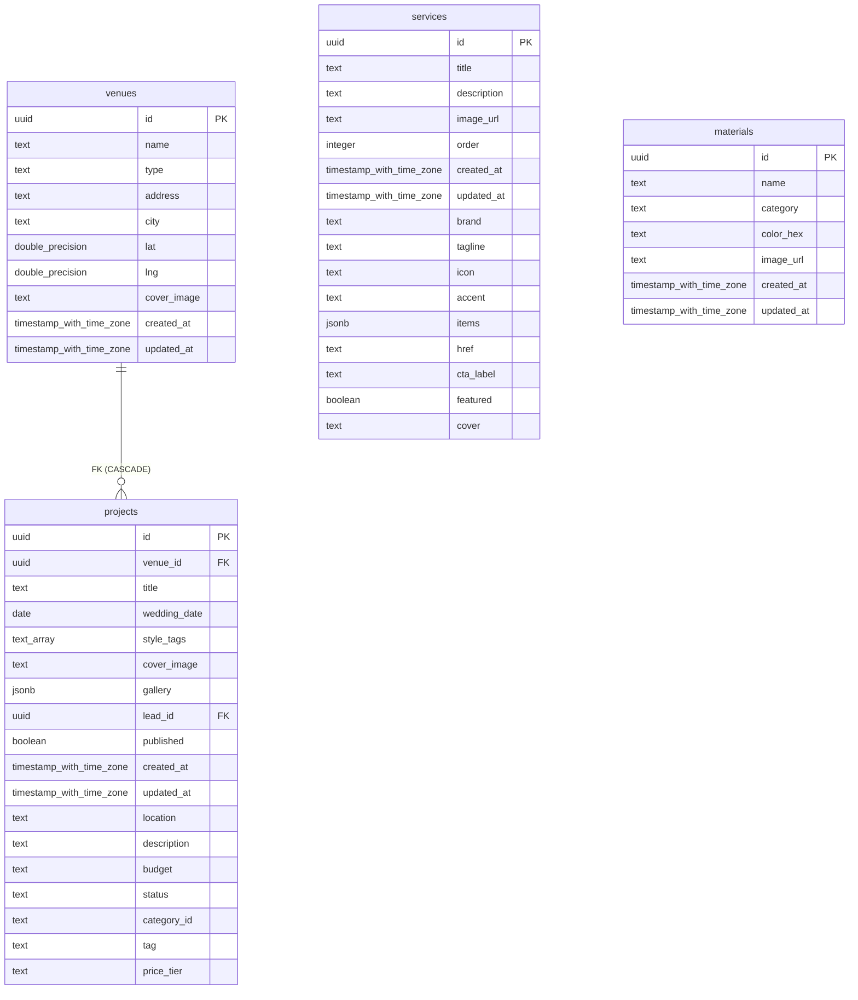
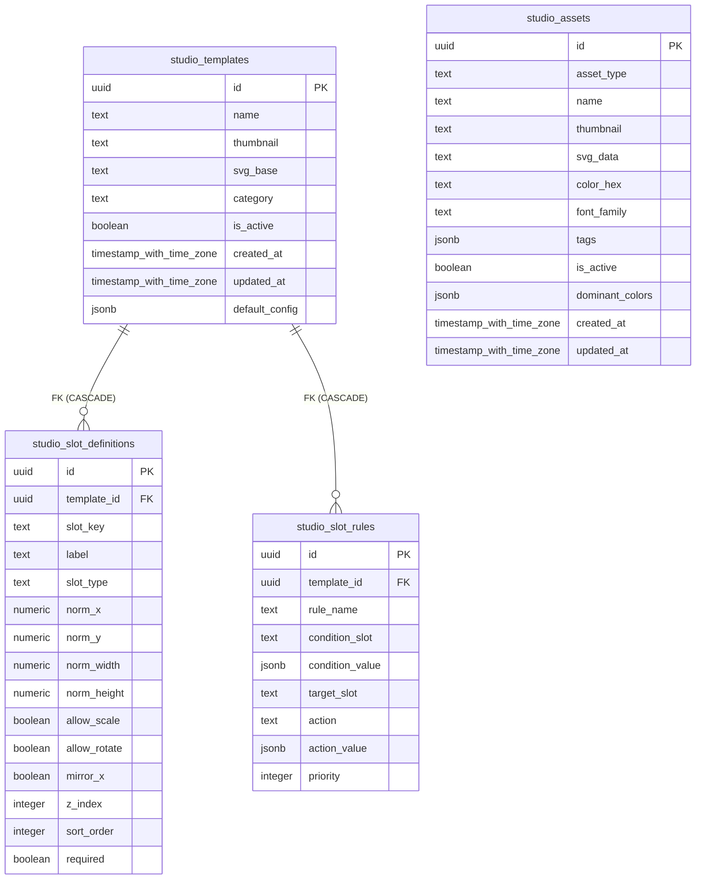
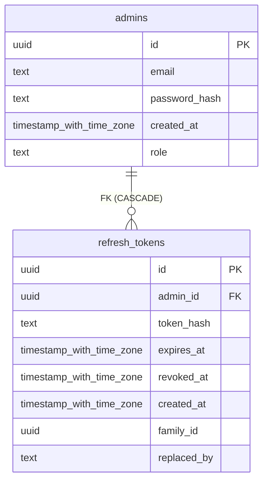

# Sơ Đồ Thực Thể Quan Hệ Pi Decor (ERD)

> Sơ đồ được sinh tự động từ các ràng buộc khóa ngoại (Foreign Keys) trong cơ sở dữ liệu PostgreSQL.

## 1. Sơ Đồ Tổng Thể Hệ Thống

---

## 2. Phân Hệ CRM Khách Hàng & Báo Giá

---

## 3. Phân Hệ Quản Lý Nội Dung & Dự Án

---

## 4. Phân Hệ Studio Thiết Kế Không Gian

---

## 5. Phân Hệ Xác Thực & Quản Trị Viên

---
