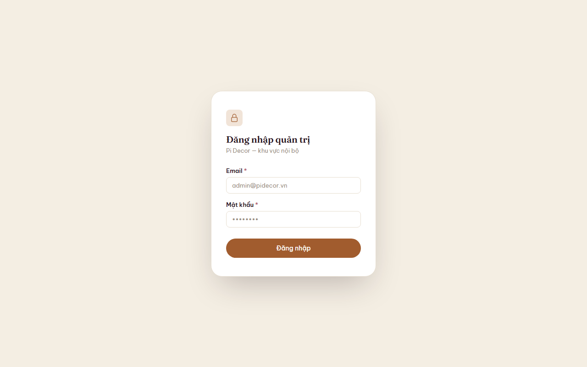
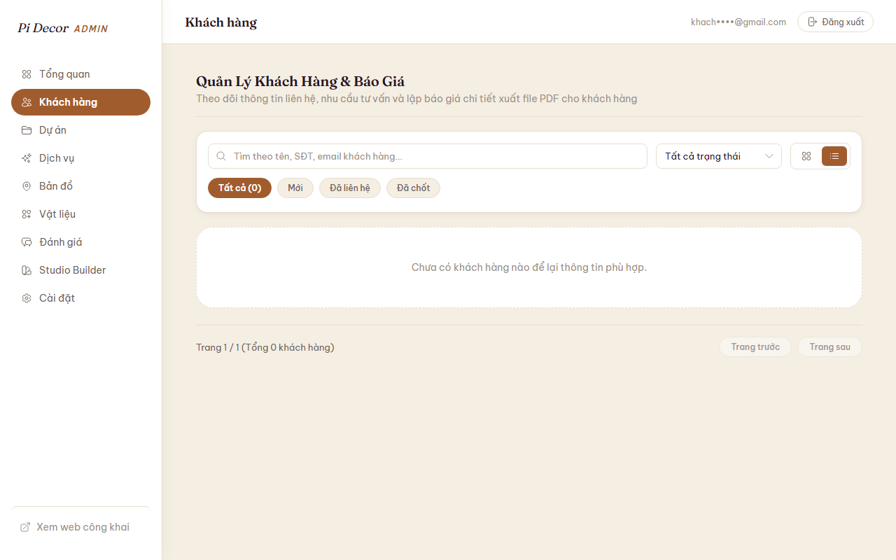
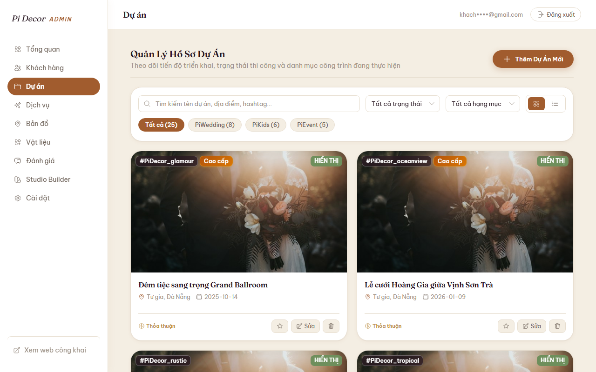
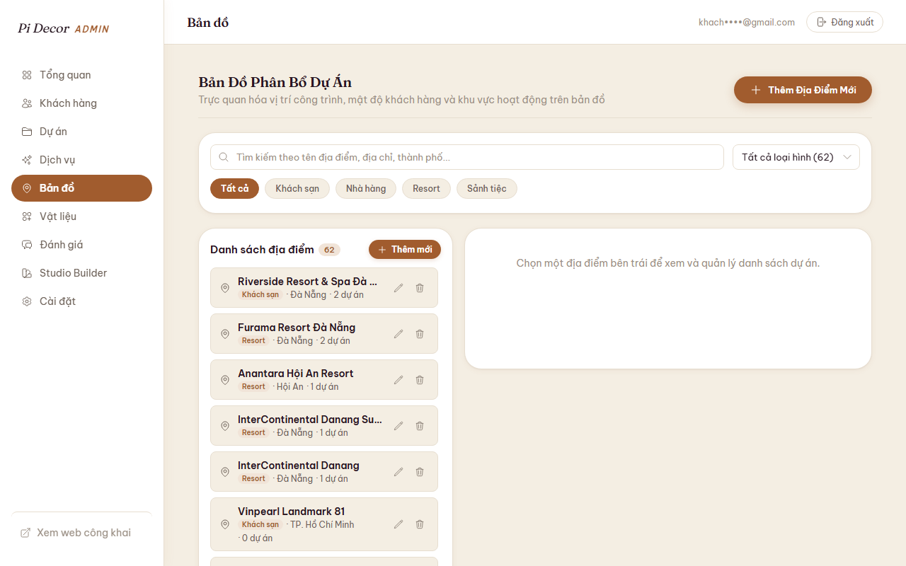
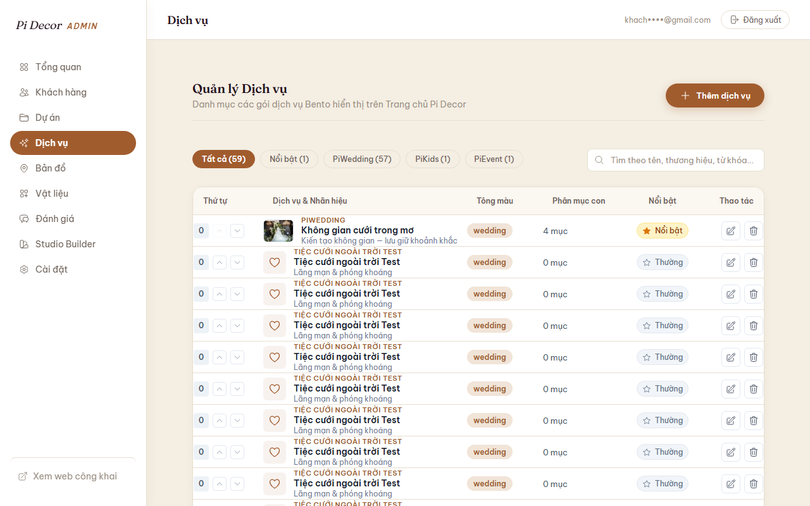
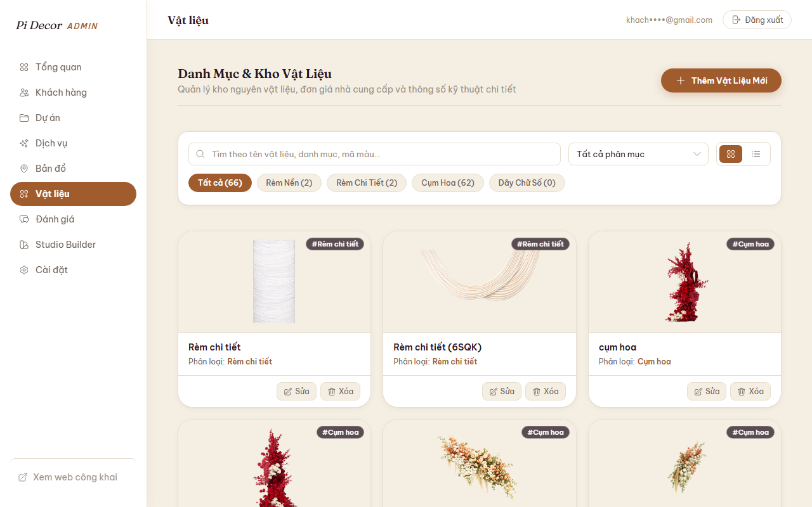
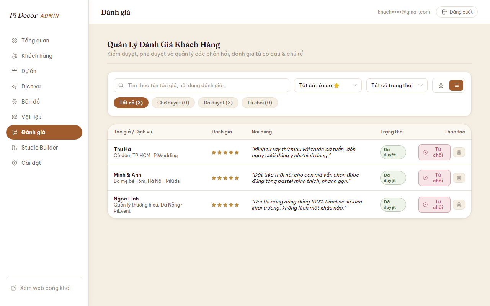
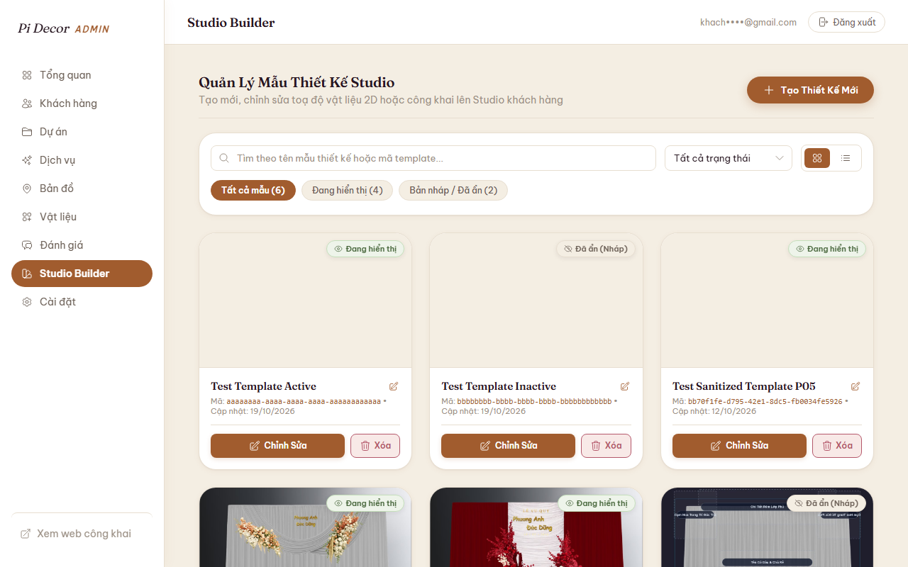
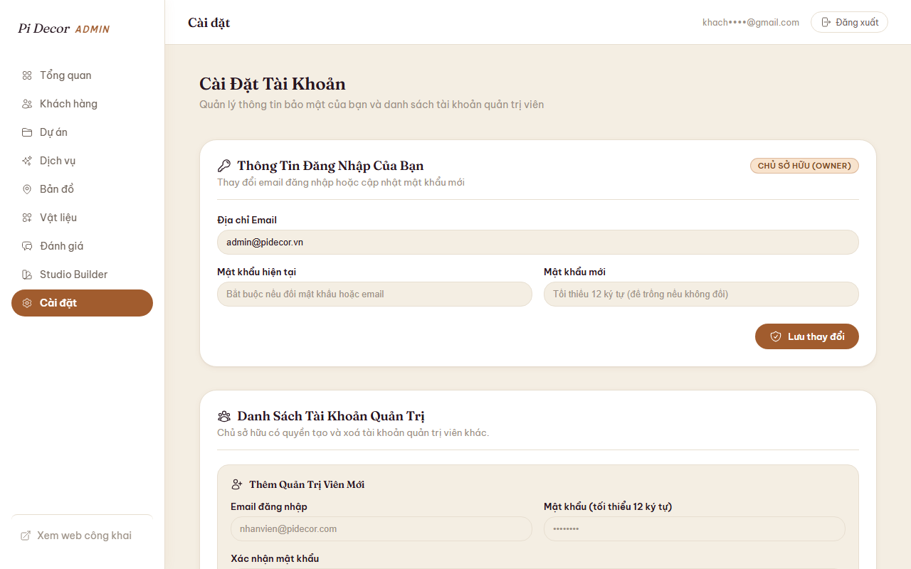

# Cẩm Nang Quản Trị Hệ Thống Pi Decor (ADMIN_GUIDE.md)

Tài liệu hướng dẫn thao tác vận hành dành riêng cho Chủ doanh nghiệp và Quản trị viên Pi Decor. Toàn bộ các bước được chuẩn hóa theo quy trình trực quan: **Làm gì → Bấm ở đâu → Kết quả**.

---

## 1. Đăng Nhập & Đổi Mật Khẩu Quản Trị



- **Làm gì**: Đăng nhập vào không gian làm việc quản trị hoặc cập nhật mật khẩu định kỳ.
- **Bấm ở đâu**:
  - Truy cập địa chỉ `/admin/login`.
  - Nhập **Email** và **Mật khẩu** quản trị, sau đó bấm nút **"Đăng Nhập"**.
  - Để đổi mật khẩu: Sau khi đăng nhập, chọn menu **"Cài đặt"** (`/admin/settings`), điền mật khẩu hiện tại và mật khẩu mới (tối thiểu 12 ký tự), bấm **"Cập Nhật Mật Khẩu"**.
- **Kết quả**: Hệ thống tự động chuyển tiếp vào Bảng điều khiển trung tâm (`/admin/dashboard`). Khi đổi mật khẩu thành công, các phiên đăng nhập cũ trên thiết bị khác sẽ được tự động thu hồi để bảo vệ tài khoản.

---

## 2. Tiếp Nhận & Xử Lý Khách Hàng Tiềm Năng (Leads)



- **Làm gì**: Theo dõi danh sách khách đăng ký tư vấn từ trang chủ hoặc xưởng Studio, cập nhật tiến độ chăm sóc.
- **Bấm ở đâu**:
  - Chọn menu **"Khách hàng & Báo giá"** (`/admin/leads`).
  - Lọc nhanh theo trạng thái (`Mới tiếp nhận`, `Đang tư vấn`, `Đã báo giá`, `Chốt hợp đồng`, `Hủy`).
  - Bấm vào một dòng khách hàng để mở ngăn kéo chi tiết (Drawer).
  - Đổi trạng thái tại ô chọn trạng thái hoặc chuyển sang tab **"Hoạt động"**, nhập nội dung trao đổi và bấm **"Ghi nhận"**.
- **Kết quả**: Trạng thái lead cập nhật ngay lập tức. Toàn bộ lịch sử tư vấn, ghi chú cuộc gọi và thông tin phông cưới khách tự phối (snapshot) được lưu trữ vĩnh viễn trên dòng thời gian.

---

## 3. Lập & Gửi Báo Giá Tiệc Cưới (Quotations)


- **Làm gì**: Tạo bảng dự toán chi phí chi tiết cho khách hàng kèm mã số tự động.
- **Bấm ở đâu**:
  - Trong ngăn kéo chi tiết của khách hàng (`/admin/leads`), chuyển sang tab **"Báo giá"**.
  - Bấm **"Tạo Báo Giá Mới"**, nhập các hạng mục thi công (tên hạng mục, đơn giá, số lượng), chiết khấu (nếu có) và ngày hết hạn.
  - Bấm **"Lưu Bản Nháp"** hoặc **"Duyệt & Xuất Báo Giá"**.
- **Kết quả**: Hệ thống tự động sinh số báo giá nguyên tử dạng `BG-YYYY-XXXX` (ví dụ `BG-2026-0001`), tính toán chính xác tổng tiền và cho phép tải file PDF gửi trực tiếp cho khách hàng.

---

## 4. Quản Lý Dự Án Lookbook & Địa Điểm Tổ Chức



- **Làm gì**: Đăng tải các bộ ảnh tiệc cưới thực tế đã thi công và quản lý danh sách nhà hàng/khách sạn liên kết.
- **Bấm ở đâu**:
  - **Dự án**: Chọn menu **"Dự án"** (`/admin/projects`) → Bấm **"Thêm Dự Án Mới"** → Điền tên cô dâu chú rể, phân khúc giá (Standard/Premium), chọn địa điểm tổ chức, tải ảnh bìa và album ảnh → Chọn trạng thái **"Xuất bản"** hoặc **"Bản nháp"** → Bấm **"Lưu Dự Án"**.
  - **Địa điểm**: Chọn menu **"Địa điểm"** (`/admin/venues`) → Bấm **"Thêm Địa Điểm"** → Nhập tên nhà hàng, địa chỉ, tọa độ bản đồ → Bấm **"Lưu"**.
- **Kết quả**: Dự án đã xuất bản sẽ hiển thị ngay tại mục Lookbook trên trang chủ. Dự án ở trạng thái bản nháp chỉ hiển thị trong trang quản trị.



---

## 5. Quản Lý Danh Mục Gói Dịch Vụ & Bảng Vật Liệu



- **Làm gì**: Cập nhật giá niêm yết các gói dịch vụ và quản lý thư viện chất liệu vải, bảng màu hoa.
- **Bấm ở đâu**:
  - **Dịch vụ**: Chọn menu **"Dịch vụ"** (`/admin/services`) → Chọn gói cần sửa → Cập nhật mô tả, các quyền lợi đính kèm, ảnh đại diện hoặc kéo thả thay đổi thứ tự hiển thị → Bấm **"Lưu Thay Đổi"**.
  - **Vật liệu**: Chọn menu **"Vật liệu"** (`/admin/materials`) → Bấm **"Thêm Vật Liệu"** → Chọn loại (lụa, voan, hoa, phụ kiện), chọn mã màu HEX và tải mẫu ảnh thực tế → Bấm **"Lưu"**.
- **Kết quả**: Thông tin dịch vụ và bảng vật liệu trên giao diện khách hàng được làm mới tức thì.



---

## 6. Kiểm Duyệt Đánh Giá Của Khách Hàng (Testimonials)



- **Làm gì**: Xem xét, phê duyệt hoặc từ chối các cảm nhận, lời khen do khách hàng gửi về website.
- **Bấm ở đâu**:
  - Chọn menu **"Đánh giá"** (`/admin/testimonials`).
  - Xem danh sách phản hồi đang ở tab **"Chờ duyệt"**.
  - Bấm nút **"Duyệt"** (màu xanh) để cho phép hiển thị, hoặc **"Từ chối"** (màu xám) đối với các đánh giá không phù hợp.
- **Kết quả**: Đánh giá được duyệt sẽ lập tức xuất hiện tại mục Cảm nhận khách hàng trên trang chủ. Đánh giá từ chối hoặc đang chờ duyệt sẽ bị ẩn hoàn toàn khỏi trang công khai.

---

## 7. Quản Trị Bản Mẫu Xưởng Phối Cảnh (Studio)



- **Làm gì**: Thêm hoặc cập nhật các khung phông nền đồ họa SVG để cô dâu chú rể tự thiết kế tiệc cưới trực quan.
- **Bấm ở đâu**:
  - Chọn menu **"Studio"** (`/admin/studio`).
  - Bấm **"Thêm Template Mới"** → Đặt tên mẫu phông cưới, tải file đồ họa SVG, cấu hình các vùng cho phép đổi màu (slots) và quy tắc kết hợp (rules) → Bấm **"Xuất Bản"**.
- **Kết quả**: Hệ thống tự động làm sạch mã độc trong file SVG và đưa mẫu mới lên giao diện xưởng thiết kế `/studio`.

---

## 8. Quản Lý Tài Khoản Quản Trị Viên



- **Làm gì**: Chủ tài khoản (Owner) cấp mới tài khoản cho nhân viên tư vấn hoặc thu hồi quyền truy cập khi nhân sự nghỉ việc.
- **Bấm ở đâu**:
  - Chọn menu **"Cài đặt"** (`/admin/settings`) → Cuộn xuống phần **"Danh Sách Quản Trị Viên"**.
  - Để thêm: Nhập Email, mật khẩu ban đầu và bấm **"Tạo Tài Khoản"**.
  - Để xóa: Bấm nút **"Xóa"** bên cạnh tài khoản nhân viên cần thu hồi.
- **Kết quả**: Nhân viên mới có thể đăng nhập ngay. Hệ thống áp dụng quy tắc an toàn: Không cho phép tự xóa chính mình và không được phép xóa tài khoản Chủ sở hữu (Owner) cuối cùng.

---

## 9. Xử Lý Yêu Cầu Xóa / Xuất Dữ Liệu Khách Hàng (Nghị Định 13)

- **Làm gì**: Tiếp nhận yêu cầu của khách hàng muốn xem lại toàn bộ thông tin cá nhân hoặc yêu cầu xóa vĩnh viễn dữ liệu khỏi hệ thống.
- **Quy trình xử lý**:
  - **Khách xin bản sao dữ liệu**: Ghi nhận Email hoặc Số điện thoại của khách → Bàn giao cho Bộ phận Kỹ thuật chạy công cụ trích xuất:
    ```bash
    node apps/api/scripts/export-lead.js --email="khach@example.com"
    ```
  - **Khách yêu cầu xóa dữ liệu**: Sau khi đã hoàn tất hợp đồng hoặc khách từ chối tư vấn → Bàn giao Bộ phận Kỹ thuật chạy công cụ thanh lọc:
    ```bash
    node apps/api/scripts/delete-lead.js --email="khach@example.com" --confirm
    ```
- **Lưu ý quan trọng**: Quản trị viên **không tự ý sửa cơ sở dữ liệu**. Việc xóa và trích xuất dữ liệu cá nhân phải tuân thủ quy trình kỹ thuật để lưu vết biên bản kiểm toán bảo mật.

---

## 10. Mẹo Vận Hành & Xử Lý Lỗi Thường Gặp

1. **Phiên làm việc hết hạn đột ngột**: Khi màn hình thông báo phiên hết hạn hoặc chuyển hướng về `/admin/login`, vui lòng đăng nhập lại. Đây là cơ chế bảo mật xoay vòng khóa tự động sau thời gian không thao tác.
2. **Không tải được ảnh lên**: Kiểm tra dung lượng tệp ảnh. Hệ thống chỉ chấp nhận ảnh có kích thước dưới 10MB và thuộc định dạng JPG, PNG, WEBP, SVG.
3. **Mất kết nối dữ liệu**: Nếu bảng danh sách tải chậm hoặc báo lỗi 503, cơ sở dữ liệu đám mây Neon có thể đang trong giây lát đánh thức compute. Hãy đợi 3–5 giây và bấm phím `F5` để tải lại trang.
